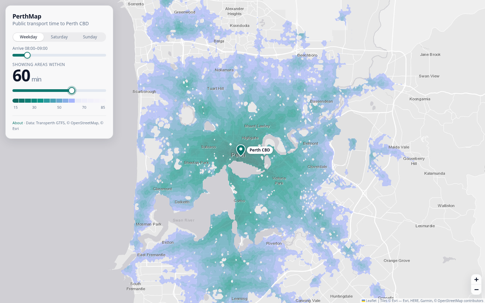
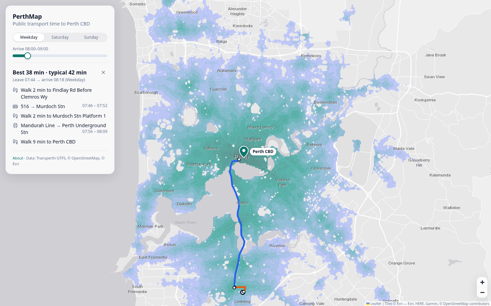
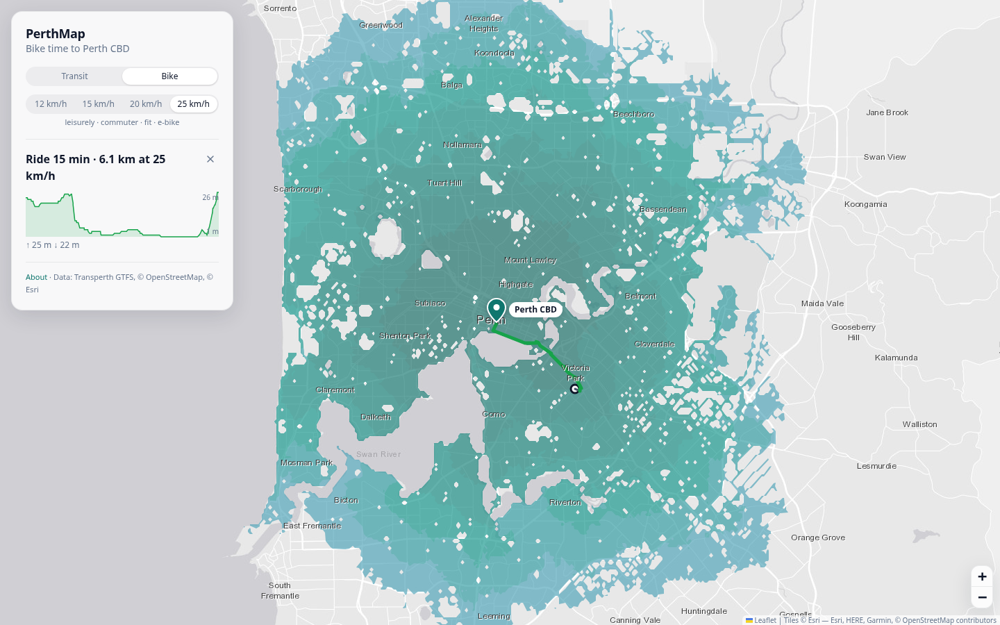

# [PerthMap](https://perthmap.phteven.space/)

## What
I couldn't find a good source of truth for "How long will it take me to get to work" using public transport, so I built one.

Pick a day (weekday, Saturday or Sunday) and a one-hour arrival window (06:00–22:00): the map shades everywhere you
can reach the Perth CBD from within the selected minutes (the typical time over that hour). Darker is faster.

### Click anywhere for the route
Clicking a point shows its fastest trip in that window — when to leave, the walk to the stop, each bus, train or
ferry leg with its times, and the walk at the end — and draws it on the map.

### Service changes through the week
The same 60 minutes covers far less ground early on a Sunday than on a weekday morning.

### Cycling
Switch to **Bike** to see how far you can ride to the CBD in the selected minutes at 12, 15, 20 or 25 km/h
(leisurely to e-bike). Clicking a point shows the ride's time and distance at that speed, the street route, and an
elevation profile with the total climb and descent.

### On a phone

## Tools used

* [MOTIS](https://github.com/motis-project/motis) (in Docker) as the public transport router to calculate how long it takes to get from A to B.
* [OpenStreetMaps Oceania](https://download.geofabrik.de/australia-oceania/australia.html) for map data including routes.
* [Transperths GTFS feed](https://www.transperth.wa.gov.au/About/Spatial-Data-Access) for up to date public transit route information
* [SRTM elevation](https://registry.opendata.aws/terrain-tiles/) (AWS Open Data terrain tiles) for the bike elevation profiles.
* Python for data preperation
* React-Leaflet + Vite + Tailwind for data presentation, on Esri's Light Gray Canvas basemap

# Data
See [data_gen](data_gen/README.md) for how to generate data (`docker compose up --build route`, `docker compose run --rm route bike`, then copy
`data_gen/data/results/web/` to `public/data/`). The site is static: each window is a small gzipped travel-time grid
plus a route table, fetched on demand and contoured in the browser.

# Checks
`npm test` (web), `cd data_gen/data && uv run --group dev pytest ../tests -q` (pipeline), and with `npx vite preview
--port 4789` running, `uv run --with playwright==1.58.0 python scripts/e2e-route.py` (end to end).
