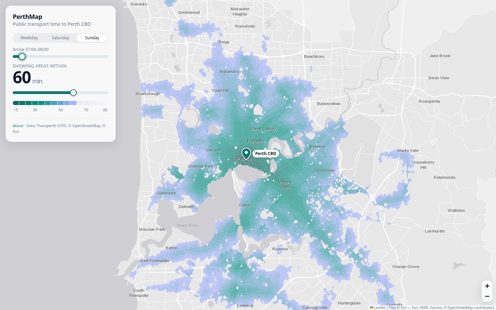
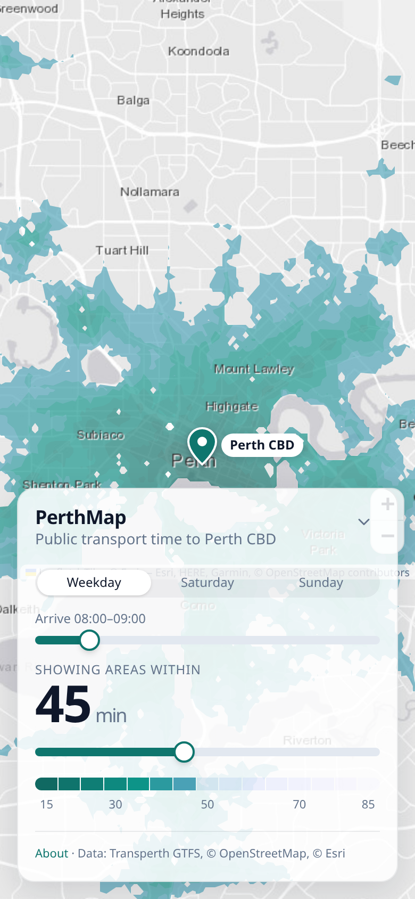

# [PerthMap](https://perthmap.phteven.space/)

## What
I couldn't find a good source of truth for "How long will it take me to get to work" using public transport, so I built one.

Pick a day (weekday, Saturday or Sunday) and a one-hour arrival window (06:00–22:00): the map shades everywhere you
can reach the Perth CBD from within the selected minutes (the typical time over that hour). Darker is faster.

### Click anywhere for the route
Clicking a point shows its fastest trip in that window — when to leave, the walk to the stop, each bus, train or
ferry leg with its times, and the walk at the end — and draws it on the map.

### Service changes through the week
The same 60 minutes covers far less ground early on a Sunday than on a weekday morning.

### Search an address, see its schools
Search an address (or click anywhere) for a report: the fastest route to the CBD and the public primary and
secondary school whose local intake area covers it. Pick schools under *Limit to school intake areas* to shade only
the parts of their intake areas within your travel time. Intake areas are extracted from the Department of
Education's intake maps (312 of the 403 metro public schools; the rest have no usable map), so they are approximate:
near a boundary, check the [official lookup](https://www.det.wa.edu.au/schoolsonline/home.do).

### On a phone

## Tools used

* [MOTIS](https://github.com/motis-project/motis) (in Docker) as the public transport router to calculate how long it takes to get from A to B.
* [OpenStreetMaps Oceania](https://download.geofabrik.de/australia-oceania/australia.html) for map data including routes.
* [Transperths GTFS feed](https://www.transperth.wa.gov.au/About/Spatial-Data-Access) for up to date public transit route information
* Python for data preperation
* React-Leaflet + Vite + Tailwind for data presentation, on Esri's Light Gray Canvas basemap
* Local intake areas © [Department of Education WA](https://www.det.wa.edu.au/schoolsonline/home.do), CC BY 4.0,
  derived from its intake maps; school locations DET-024 (CC BY-NC 4.0) via [DataWA/SLIP](https://data.wa.gov.au)
* Address search by [Nominatim](https://nominatim.org) (© OpenStreetMap contributors), on submit only

# Data
See [data_gen](data_gen/README.md) for how to generate data (`docker compose up --build route`, then
`docker compose run --rm --no-deps route schools`, then copy `data_gen/data/results/web/` to `public/data/`). The site is static: each window is a small gzipped travel-time grid
plus a route table, fetched on demand and contoured in the browser.

# Checks
`npm test` (web), `cd data_gen/data && uv run --group dev pytest ../tests -q` (pipeline), and with `npx vite preview
--port 4789` running, `uv run --with playwright==1.58.0 python scripts/e2e-route.py` (end to end; `--url` for
another port).
