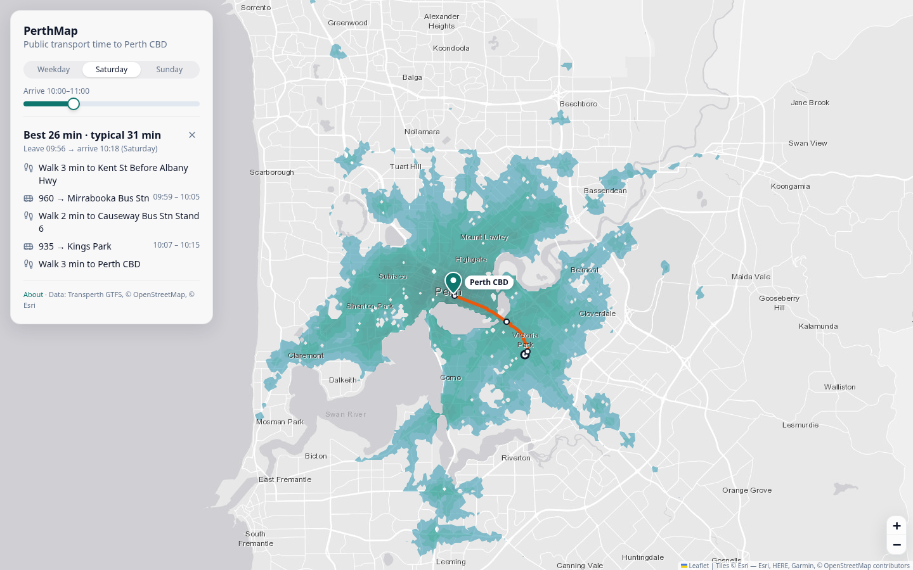
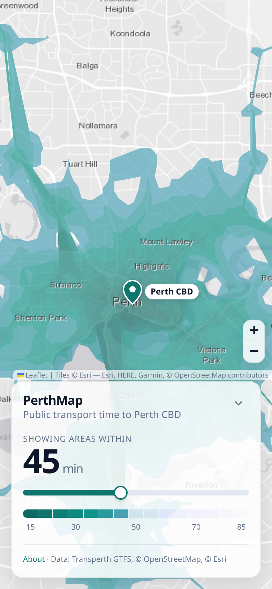

# [PerthMap](https://perthmap.phteven.space/)

## What
I couldn't find a good source of truth for "How long will it take me to get to work" using public transport, so I built one.

Pick a day (weekday, Saturday or Sunday) and a one-hour arrival window (06:00–22:00): the map shades everywhere you
can reach the Perth CBD from within the selected minutes (the typical time over that hour). Click any point to see
its fastest route — the walk to the stop, each bus/train/ferry leg with its times, and when to leave.

## Tools used

* [MOTIS](https://github.com/motis-project/motis) (in Docker) as the public transport router to calculate how long it takes to get from A to B.
* [OpenStreetMaps Oceania](https://download.geofabrik.de/australia-oceania/australia.html) for map data including routes.
* [Transperths GTFS feed](https://www.transperth.wa.gov.au/About/Spatial-Data-Access) for up to date public transit route information
* Python for data preperation
* React-Leaflet + Vite + Tailwind for data presentation, on Esri's Light Gray Canvas basemap

# Data
See [data_gen](data_gen/README.md) for how to generate data (`docker compose up --build route`, then copy
`data_gen/data/results/web/` to `public/data/`). The site is static: each window is a small gzipped travel-time grid
plus a route table, fetched on demand and contoured in the browser.

# Checks
`npm test` (web), `cd data_gen/data && uv run --group dev pytest ../tests -q` (pipeline), and with `npx vite preview
--port 4789` running, `uv run --with playwright==1.58.0 python scripts/e2e-route.py` (end to end).
